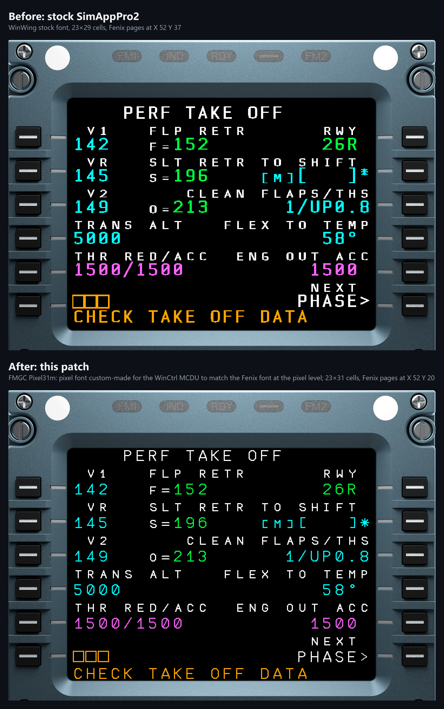
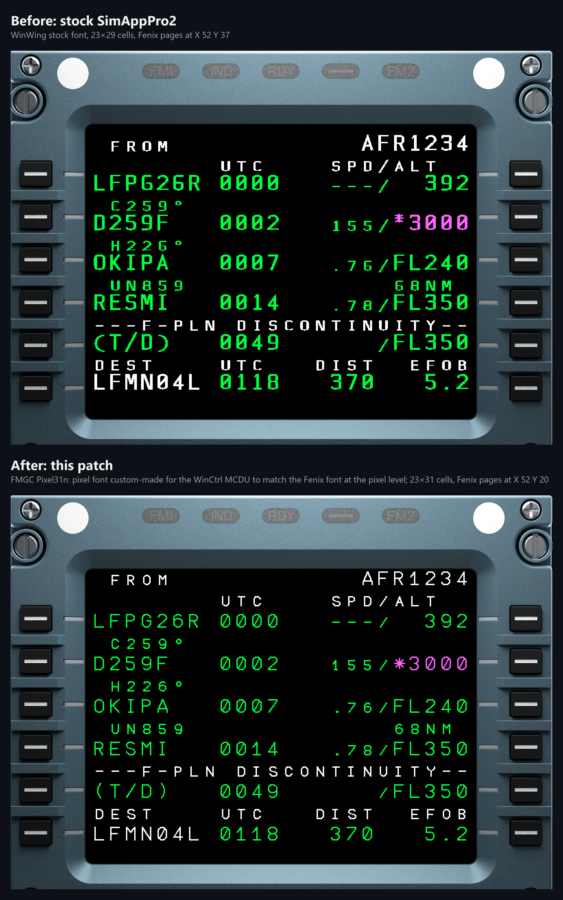
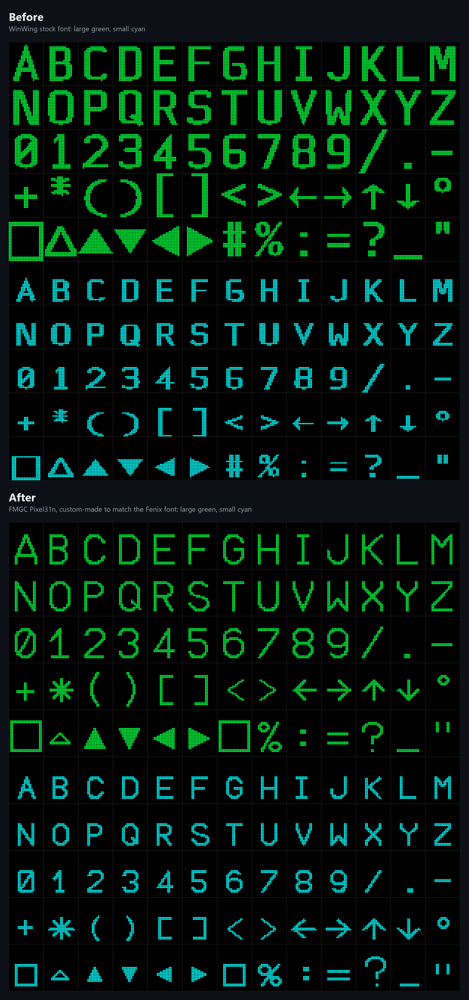
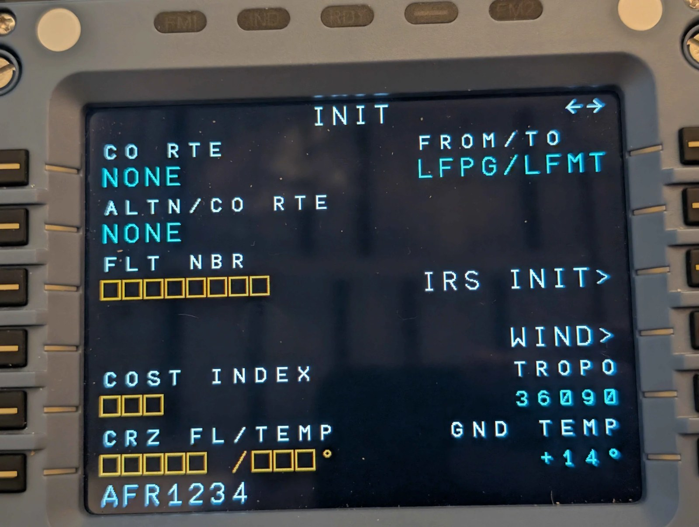
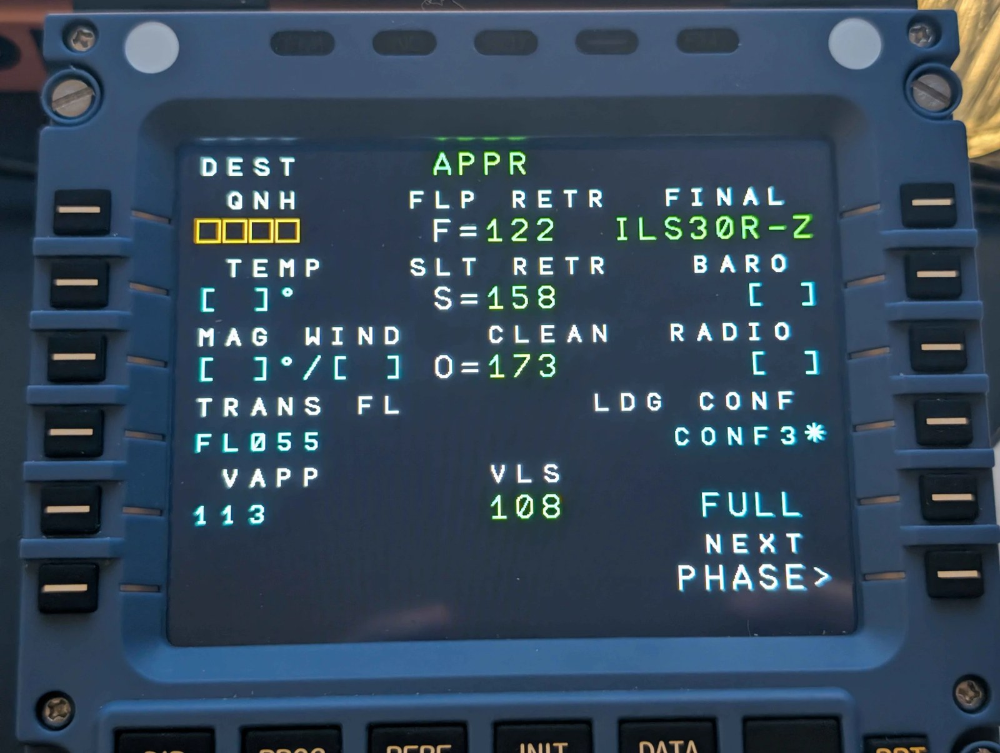

# WC MCDU Fenix Patch

One-click setup for the **WinCtrl (WinWing) MCDU** with the **Fenix A320** in MSFS. It turns a
stock SimAppPro2 install into a screen that looks like the Fenix MCDU:

- **FMGC Pixel31n**, a pixel font custom-made for the WinCtrl MCDU to match the Fenix font at
  the pixel level,
- the Fenix colours,
- the Fenix pages moved up so each data line sits on its line-select key.

**[⬇ Download the latest release](https://github.com/paul-charp/WC-MCDU-Fenix-Patch/releases/latest)** · **[Install instructions](#install)**

> [!IMPORTANT]
> **This needs SimAppPro2**, WinWing's newer app. It does **not** work with the original
> **SimAppPro** (version 1), which most MCDU owners still have: install SimAppPro2 first and run
> the MCDU with it. This patch only configures SimAppPro2.

> **About the fonts.** `FMGC Pixel31n` is not the Fenix font: it was rebuilt pixel by pixel on
> the MCDU's 23 × 31 grid to match the look of the Fenix FMGC font (FlightBus, Jesper
> Giørtz-Behrens). It contains none of the original font files or outlines.

## Before / after

Pixel renders of the MCDU screen (640 × 480), decoded from the font data SimAppPro2 actually
sends to the device and placed at the origin SimLogic sends for the Fenix pages. The screen is
shown behind SimAppPro2's own MCDU bezel picture, scaled as on the real unit: with the patch,
each line-select key sits on its data line. *Before* is a stock SimAppPro2 install; *after* is
this patch. Open an image for full size.





Glyph sheet (each square is one MCDU pixel):



### On the real MCDU

Photos of the patched MCDU with the Fenix A320, INIT and PERF APPR pages:





## Install

**[⬇ Download the latest release](https://github.com/paul-charp/WC-MCDU-Fenix-Patch/releases/latest)**

You need:

- Windows, with MSFS and the Fenix A320
- the WinWing MCDU, plugged in by USB
- **SimAppPro2, not the original SimAppPro (version 1)**: installed, and opened at least once with
  the MCDU plugged in. SimAppPro2 installs to `%LOCALAPPDATA%\SimAppPro2`. If you only have
  SimAppPro, install SimAppPro2 from WinWing's website first.

Nothing else: no Python or other software to install.

1. **Download** `WinCtrl-MCDU-Fenix-A320-Patch-<version>.zip` from the
   [latest release](https://github.com/paul-charp/WC-MCDU-Fenix-Patch/releases/latest), under *Assets*.
2. **Unzip it**: right-click the zip, **Extract All…**, then **Extract**. Put the folder anywhere,
   for example in `Documents`. Keep the `_internal` folder next to `WC-MCDU-Fenix-Patch.exe`: the
   program needs it.
3. **Plug in the MCDU** if it isn't already. SimAppPro2 and the sim can stay open: the setup closes
   and reopens SimAppPro2 by itself.
4. **Double-click `WC-MCDU-Fenix-Patch.exe`** in the unzipped folder.
   - First time only, if Windows shows *"Windows protected your PC"*: click **More info**, then
     **Run anyway**. (The program is not code-signed.)
5. In the menu, **press 2** (Full install).
6. **Wait about a minute** while the progress bar runs. Leave SimAppPro2 alone: it closes and
   reopens on its own.
7. When the window shows **Done: everything is in place.**, press **Enter** to go back to the menu,
   then **Q** to close it. The MCDU now shows the new font, colours and layout.

If the lines don't sit quite right next to the keys on your MCDU, use
[Height adjust](#height-adjust).

If a line shows ✘, or the setup stops with a message, see [Troubleshooting](#troubleshooting).

The menu:

```
╭─ WinWing MCDU · Fenix A320 ─────────╮
│  MCDU   connected (Captain)         │
│  Patch  installed, height offset 0  │
╰─────────────────────────────────────╯

  1  Check only      show what is installed, change nothing
  2  Full install    fonts, layout, colours, page position (about 1 min)
  3  Height adjust   move the Fenix pages up or down
  4  Reset           WinWing factory settings, or a backup
  Q  Quit
```

A successful install looks like this:

```
╭─ WinWing MCDU · Fenix A320 · setup ─────────────────────────╮
│  MCDU        connected (Captain)                            │
│  Fonts       FMGC-Pixel31n-Large / FMGC-Pixel31n-Small      │
│  Grid        X 16  Y 20  23x31 cells                        │
│  Height      offset 0  (default)                            │
│  Colours     Fenix web MCDU                                 │
│  SimAppPro2  will be closed and restarted (under a minute)  │
╰─────────────────────────────────────────────────────────────╯

  ✔ Close SimAppPro2               closed  5s
  ✔ Back up current settings       backups\20261017-013516
  ✔ Install fonts                  FMGC-Pixel31n-Large / FMGC-Pixel31n-Small
  ✔ Fenix page position            Y 20 in 26 scripts
  ✔ Grid and colours               X 16  Y 20  23x31, Fenix colours
  ✔ Send fonts to the MCDU         font set WWT_MCDU  24s
  ✔ Restart SimAppPro2             running normally  5s

Check
   ✔  Fonts installed         FMGC-Pixel31n-Large / FMGC-Pixel31n-Small
   ✔  Fonts selected          set WWT_MCDU, scale 1, no shift
   ✔  Font sent to MCDU       23x31 cells
   ✔  Grid                    X 16  Y 20  23x31  yBase 0
   ✔  Colours                 Fenix (same as WinWing's defaults)
   ✔  Fenix pages (SimLogic)  Y 20 in all 26 scripts

╭─────────────────────────────────╮
│  Done: everything is in place.  │
╰─────────────────────────────────╯
```

### After a SimAppPro2 update

**Run `WC-MCDU-Fenix-Patch.exe` again and press 2** (Full install). SimAppPro2 updates replace its
Fenix scripts, which puts the Fenix pages back at WinWing's position (the menu shows *Fenix page
position reset*); the fonts and colours stay. Your height offset is kept.

### Updating to a new version of this patch

Download the [latest release](https://github.com/paul-charp/WC-MCDU-Fenix-Patch/releases/latest),
unzip it (you can delete the old folder), run the new `WC-MCDU-Fenix-Patch.exe` and press 2. Your
height offset is kept.

### Height adjust

With the patch installed, **press 3** in the menu to move the Fenix pages up or down on your own
MCDU, without installing everything again. Start the Fenix first and show a page with text next
to all the keys (INIT or PERF TAKE OFF).

Type an offset in pixels and press **Enter**: the MCDU shows it a moment later. **0** is the
default position, a **positive** number moves the text **up**, a **negative** one moves it
**down** (from -26 to +20). Try values until each line sits next to its key, then press **Enter**
on an empty line to keep it, or type **C** to cancel. A full install keeps your offset.

### Undo

Every install, height adjust and reset first saves the current settings in a
`backups\<date-time>\` folder next to the `.exe`. To put one back, **press 4** (Reset), then
**2** (A backup), and pick it: the list shows when each was made and what it holds
(`FMGC-Pixel31n, Y 20`, `WinWing settings`…).

To go back to WinWing's own settings, press **4**, then **1** (Factory settings): WinWing's font,
layout, colours and Fenix page position, sent to the MCDU. The patch fonts are removed from
SimAppPro2's font list.

### Options

The menu covers everything. The same actions also exist as command-line options: open a command
prompt in the unzipped folder (click the folder's address bar, type `cmd` and press Enter), then
type one of:

```
WC-MCDU-Fenix-Patch.exe                     the menu
WC-MCDU-Fenix-Patch.exe --check             check without changing anything (✘ = needs fixing)
WC-MCDU-Fenix-Patch.exe --install           install / re-apply everything, no menu
WC-MCDU-Fenix-Patch.exe --install --offset 2   install with the text 2 px higher (negative: lower)
WC-MCDU-Fenix-Patch.exe --restore backups\20261017-013516   put a backup back
WC-MCDU-Fenix-Patch.exe --factory-reset     WinWing's settings
```

### Run from the source instead

With Python 3 on `PATH`, clone the repository and double-click **`installer.bat`**, or run
`python setup_mcdu.py` with the same options. The first run installs the Python packages `rich`
and `websocket-client` (`pip install --user`).

### What a full install does

0. Check that a WinWing MCDU is on USB (vendor `4098`, Captain / First Officer / Observer ids);
   if not, ask to plug it in and start as soon as it is detected.
1. Close SimAppPro2.
2. Back up the MCDU settings and the SimLogic Fenix scripts to `backups\<date-time>\`.
3. Copy the fonts into SimAppPro2's own font folder (`GameExtendDisplay\Windows\Fonts`).
4. Set the Y position in the 26 SimLogic Fenix MCDU scripts (`fnx_*\WINWING_MCDU_32-L/R.js`).
5. Write the grid and colours to the MCDU settings and the selected font set.
6. Restart SimAppPro2 with a local debug port and call its own functions to select the fonts,
   convert them and send them to the MCDU.
7. Restart SimAppPro2 normally and print the check table.

If anything fails, SimAppPro2 is still restarted normally and the previous files stay in `backups\`.

Height adjust backs up, restarts SimAppPro2 with the debug port, and for each offset writes Y = 20 − offset
to the scripts and sends the layout with SimAppPro2's own functions; SimLogic then re-sends the Fenix
pages at the new position. The fonts are not sent again. Factory settings uses SimAppPro2's own reset
functions for the font, layout and colours, puts the scripts back at Y 37 and removes the patch fonts.

## What it changes

| Item | Stock SimAppPro2 | This patch |
|---|---|---|
| Font | WinWing `WWT_MCDU` | `FMGC-Pixel31n-Large` / `-Small`: pixel font custom-made for the WinCtrl MCDU to match the Fenix font at the pixel level, scale 1.0, no shift |
| Cell size | 23 × 29 | 23 × 31 |
| Editor grid | X 16, Y 17, preview yBase 20 | X 16, Y 20, preview yBase 0 (the editor's test grid matches what the sim shows) |
| Fenix page position | X 52, Y 37 (hard-coded in the SimLogic Fenix scripts) | X 52, Y 20 (minus your height offset) |
| Colours | WinWing defaults | Fenix web MCDU colours: the same values as WinWing's defaults, written explicitly so a changed palette is put back |

Fenix web MCDU colours: amber `#FFA500`, white `#FFFFFF`, cyan `#00FFFF`, green `#00FF3D`,
magenta `#FF63FF`, red `#FF0000`, yellow `#FFFF00`.

## Troubleshooting

| Message | Fix |
|---|---|
| *Windows protected your PC* | The program is not code-signed: click **More info**, then **Run anyway**. |
| The antivirus blocks or removes the `.exe` | A false positive that hits many Python-built programs. Allow it in the antivirus, or [run from the source](#run-from-the-source-instead). |
| `SimAppPro2 not found` | Only the original SimAppPro (version 1) is installed, or nothing is. Install **SimAppPro2** from WinWing's website, open it once with the MCDU plugged in, then run again. |
| `Connect the MCDU` / `No WinWing MCDU found on USB` | Plug the MCDU in (any USB port). The setup continues by itself once Windows sees it. |
| `SimAppPro2 MCDU profile not found` | Start SimAppPro2 once with the MCDU plugged in, then run again. |
| `SimAppPro2 did not create its MCDU settings` | Open the MCDU screen settings page once in SimAppPro2, close it, run again. |
| `SimAppPro2 does not list FMGC-Pixel31n-…` | SimAppPro2 reads its font list at startup: restart it, run again. |
| `Unexpected format in fnx_…` | A SimAppPro2 update changed the scripts; that file was left untouched. The pattern to update is `SIM_POINT` in `setup_mcdu.py`. |
| *Height adjust* is dimmed in the menu | It needs the patch installed: press 2 (Full install) first. |
| `SimAppPro2 is not answering` | Close SimAppPro2, then run again. |
| `SimAppPro2 did not open its debug port` | Something else is using port 9333, or SimAppPro2 failed to start. Close SimAppPro2 and run again. |

To go back to the state before a run, see [Undo](#undo).

## Why this is needed

- The WinWing MCDU is a **640 × 480** text-mode screen: it receives characters and draws the
  glyphs itself from a 1-bit font stored in its memory (`.wwf`).
- SimAppPro2 converts the selected TrueType font by lighting every pixel the outline **touches**,
  even by 1 %, which makes letters blobby. The `Pixel31n` fonts are drawn pixel by pixel so its
  conversion gives back exactly the intended design (verified: 111/111 glyphs per size).
- The text position sent to the MCDU comes from two places: the editor (X/Y/yBase settings)
  **and** SimLogic, which after every Apply re-sends its own position, hard-coded in the Fenix
  scripts (`'XAisPoint':0x34,'YAxisPoint':0x25` = 52, 37). That is why SimAppPro2's X/Y settings
  have no effect on the Fenix pages.
- The line-select keys are 69.5 px apart on the real screen; with 14 lines they cannot all be
  aligned perfectly. Y = 20 was tuned by eye on the real MCDU.

## Repository layout

```
setup_mcdu.py            install / check / restore
installer.bat            runs setup_mcdu.py with the installed Python
LICENSE                  MIT
AGENTS.md                notes for coding agents (CLAUDE.md points to it)
build_exe.py             builds dist/WC-MCDU-Fenix-Patch/ and its .zip
icon/                    the .exe icon and make_icon.py, which draws it
.github/workflows/       CI: builds the .zip, publishes releases from version tags
fonts/                   FMGC-Pixel31n-Large.ttf, FMGC-Pixel31n-Small.ttf
fonts/src/               the fonts' source: one text bitmap per character
fonts/make_ttf.py        builds the .ttf files from fonts/src/
docs/                    README screenshots, photos, render_screens.py, flightsim.to text and cover
backups/                 created by each run (git-ignored)
dist/                    the built .exe folder and .zip (git-ignored)
```

## Building the .exe

```
python build_exe.py            local build, version 0.0.0
python build_exe.py 1.2.0      version 1.2.0
```

Produces `dist\WC-MCDU-Fenix-Patch\` (`WC-MCDU-Fenix-Patch.exe` and its `_internal` folder,
about 25 MB) and `dist\WinCtrl-MCDU-Fenix-A320-Patch-<version>.zip` (about 12 MB): a PyInstaller one-folder build
holding Python, `rich`, `websocket-client` and the two fonts from `fonts\`, with Windows version
info. It installs PyInstaller, `rich` and `websocket-client` with `pip --user` if they are
missing. The `dist\` output is git-ignored; releases are built by CI (see below).

It is a one-folder build because Windows Defender's machine-learning heuristics flagged the
one-file version (a self-extracting `.exe`) as `Trojan:Win32/Bearfoos.B!ml`, a false positive.
For the same reason the script calls Windows directly (ctypes) instead of running PowerShell.

## Releases

GitHub Actions (`.github/workflows/build.yml`) builds the zip on Windows for every push to `main`
and every pull request; it is attached to the run as an artifact. Pushing a version tag also
publishes a release with `WinCtrl-MCDU-Fenix-A320-Patch-<version>.zip`, the tag message as its notes:

```
git tag -a v1.2.0 -m "- what changed"
git push origin v1.2.0
```

Then upload the same zip to flightsim.to (page text and images in `docs/flightsim-to.md`).

## Updating the screenshots

```
python docs/render_screens.py
```

It reads SimAppPro2's factory WinWing font for *before*, the font set currently sent to the MCDU
for *after*, and the bezel picture from SimAppPro2's UI assets, so run it on a machine where this
setup is installed. Needs Pillow.

## Updating the fonts

The fonts are built from text bitmaps in `fonts/src/`, one file per size. Each character is a
block of 31 rows × 23 columns, one per MCDU pixel: `#` is lit, `.` is off. The line
`baseline: 28.3` puts the baseline 28.3 px from the top of the cell, so capitals end on row 27 (rows count from 0).

```
U+0041 A
..........###..........
.........#####.........
.........##.##.........
```

To change a glyph, edit its rows and rebuild (needs `pip install fonttools`):

```
python fonts/make_ttf.py           build fonts/*.ttf from fonts/src/*.txt
python fonts/make_ttf.py --check   check that fonts/*.ttf match fonts/src/ (CI runs this)
```

Each lit pixel becomes a square inset 0.25 px from the pixel edges, at 100 font units per pixel.
SimAppPro2 lights every pixel an outline touches, so at scale 1.0 its conversion gives back
exactly these bitmaps.

For a new version, change the font name (e.g. `Pixel31o`): SimAppPro2 only reads its fonts at
startup and caches the old name. Rename both `fonts/src/*.txt` files and their `family:` line,
build, delete the old `.ttf` files (`fonts/` must hold a single `*-Large.ttf` / `*-Small.ttf`
pair), then rebuild the `.exe`. If the cell size changes, `LAYOUT` in `setup_mcdu.py` must be
updated too.

## License

[MIT](LICENSE), including the fonts in `fonts/`. Not affiliated with WinWing or Fenix Simulations.
